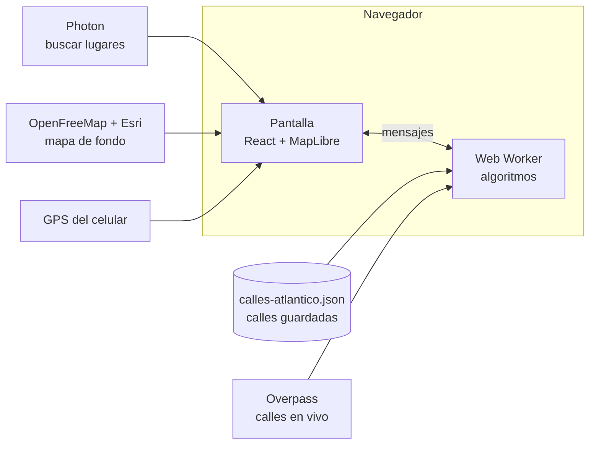

# Cómo funciona el proyecto

Explicación del stack, de dónde salen los datos, las fórmulas que se usan y qué falta. La propuesta y el plan están en [PROPUESTA.md](PROPUESTA.md).

---

## 1. Vista general

Todo corre en el navegador. No hay servidor propio: la app es un sitio estático (archivos HTML, JS y JSON) que se puede publicar gratis en Cloudflare Pages.

---

## 2. Stack y proveedores

| Pieza | Para qué | Costo y límites |
|---|---|---|
| **React 18 + TypeScript** | La pantalla (panel, botones, tablero). TypeScript es JavaScript con tipos, para detectar errores antes de correr | Gratis (open source) |
| **Vite** | Servidor de desarrollo (`npm run dev`) y empaquetado para publicar (`npm run build`) | Gratis |
| **MapLibre GL JS** | Dibuja el mapa con la GPU: inclinación 3D, edificios, rotación tipo Waze, capas del grafo | Gratis (open source) |
| **OpenFreeMap** | Teselas vectoriales del mapa de fondo (estilo "Liberty", con edificios 3D) | Gratis, sin clave |
| **Esri World Imagery** | Foto satelital de la vista Aérea | Gratis con atribución, uso razonable |
| **terra-draw** | Dibujar el rectángulo o polígono del área | Gratis (open source) |
| **OpenStreetMap (OSM)** | De aquí salen todas las calles: nombre, tipo, geometría y sentido (`oneway`) | Gratis, licencia ODbL (hay que dar crédito) |
| **Overpass API** | Descarga en vivo de calles de OSM. Se prueban 3 servidores públicos (private.coffee, overpass-api.de, mail.ru) | Gratis, pero se saturan; por eso las calles de Barranquilla y Soledad vienen guardadas |
| **calles-atlantico.json** | Calles de Barranquilla y Soledad ya descargadas (18.318 intersecciones, 28.529 tramos, 4.636 de un solo sentido, 498 reglas de giro) | 3,9 MB (866 KB comprimido); se regenera con `scripts/calles.ts` |
| **Photon (komoot)** | Buscar lugares por nombre ("Portal del Prado") mientras se escribe | Gratis, uso razonable |
| **Nominatim** | Solo se usó una vez para bajar el contorno de Barranquilla y Soledad | Gratis |
| **Geolocation API** | "Mi ubicación" con el GPS | Gratis; el navegador la da solo en https o localhost |
| **Web Worker** | Corre Dijkstra, el emparejamiento y Hierholzer en otro hilo, para que el mapa no se congele | Parte del navegador |
| **Blossom (copia de edmonds-blossom)** | Emparejamiento de costo mínimo con muchos impares | MIT; se corrigieron variables sin declarar |
| **KaTeX** | Escribe las fórmulas (como en LaTeX) en el paso a paso del tablero | Gratis (open source) |
| **Google Drive API + Google Identity Services** | Guardar y abrir recorridos en tu Drive (carpeta CarteroChino), con el permiso `drive.file` | Gratis; hay que crear un ID de cliente en Google Cloud (ver §6) |
| **Vitest** | 17 pruebas automáticas del núcleo (`npm test`) | Gratis |
| **Cloudflare Pages** | Publicar la app con https (pendiente) | Plan gratis |

**Costo total: $0.** No se usa Google Maps ni ningún servicio que cobre.

---

## 3. Cómo se arma el grafo

1. **Vértices**: un nodo de OSM se vuelve vértice si lo comparten 2 o más calles (un cruce) o si es el final de una calle.
2. **Aristas**: cada tramo de calle entre dos vértices. Su **peso** es la longitud en metros, sumando la distancia entre los puntos de su dibujo.
3. **Contracción**: si un vértice queda con grado 2 y no es un cruce (la calle solo cambió de nombre en OSM), sus dos aristas se unen en una.
4. **Recorte**: se quedan los tramos con sus dos extremos dentro del área.
5. **Componente mayor**: si el área queda en pedazos, se usa el más grande (los demás se ven en gris).
6. **Sentidos**: `oneway=yes` → arco de u a v; `oneway=-1` → se guarda al revés; las glorietas también son de un sentido.

**Puentes y túneles.** En OSM, una calle que pasa por encima o por debajo de otra **no comparte nodo** con ella. Por eso no se crea un cruce y el grafo no deja "doblar" desde el puente a la calle de abajo. Pasa lo mismo con la trampa del dibujo vista en clase: que dos líneas se crucen en el dibujo no crea un vértice.

**Margen del área.** Un cruce que quede hasta 30 m por fuera del área dibujada también entra, para que no haya que poner las esquinas exactas.

**Giros prohibidos.** OSM los guarda como relaciones `type=restriction`: desde una calle (`from`), por un cruce (`via`), hacia otra (`to`), con tipo `no_left_turn`, `no_u_turn`, `only_straight_on`, etc. `scripts/calles.ts` las pasa a índices del grafo usando de qué vía de OSM viene cada extremo de arista. Las que pasan "por una calle" en vez de por un cruce no se usan todavía.

**Pedazos sueltos.** Si al editar queda un vértice o un grupo sin conexión, la ruta se calcula sobre el pedazo más grande (la componente conexa mayor) y la app avisa qué vértices quedaron por fuera.

**Curvas.** Una calle curva es una sola arista, pero su dibujo tiene muchos puntos. El peso es la longitud real de la curva, no la línea recta entre sus extremos.

---

## 4. Fórmulas

### 4.1 Distancia entre dos puntos (haversine)

La Tierra es una esfera de radio R = 6.371.008,8 m. Con latitudes φ y longitudes λ en radianes:

$$d = 2R \cdot \arcsin\sqrt{\sin^2\frac{\Delta\varphi}{2} + \cos\varphi_1\cos\varphi_2\sin^2\frac{\Delta\lambda}{2}}$$

Longitud de un tramo = suma de $d$ entre sus puntos consecutivos.

### 4.2 Rumbo y giros (para las instrucciones de navegación)

$$\theta = \operatorname{atan2}\big(\sin\Delta\lambda\cos\varphi_2,\ \cos\varphi_1\sin\varphi_2 - \sin\varphi_1\cos\varphi_2\cos\Delta\lambda\big)$$

Giro = rumbo de la calle siguiente − rumbo de la actual, llevado a (−180°, 180°]:

| \|giro\| | Instrucción |
|---|---|
| < 20° | Sigue derecho |
| 20°–50° | Mantente a la derecha/izquierda |
| 50°–150° | Gira a la derecha (positivo) o izquierda (negativo) |
| ≥ 150° | Vuelta en U |

### 4.3 Área y "punto dentro del área"

- **¿Está dentro?** Método del rayo: se traza una línea horizontal desde el punto y se cuentan los bordes del polígono que cruza. Impar = dentro.
- **Área**: fórmula del zapato (shoelace) sobre coordenadas pasadas a kilómetros: $A = \tfrac12\left|\sum (x_i y_{i+1} - x_{i+1} y_i)\right|$.

### 4.4 Teoría de clase que la app verifica

- **Apretón de manos**: $\sum_v \deg(v) = 2|E|$, así que los vértices impares siempre vienen en número par.
- **Teorema de Euler**: hay circuito de Euler ⇔ el grafo es conexo y todos los grados son pares.
- **Dirigido**: hay circuito de Euler ⇔ es fuertemente conexo y $\deg^+(v) = \deg^-(v)$ en todo vértice.

### 4.5 Clasificación del recorrido

La app dice qué es la ruta con las definiciones de clase:

| | ¿Repite aristas? | ¿Repite vértices? | Abierto | Cerrado |
|---|---|---|---|---|
| | Sí | — | Camino | Camino cerrado |
| | No | Sí | Sendero | Circuito |
| | No | No | Trayectoria | Circuito simple |

Si además usa **cada arista exactamente una vez**: sendero de Euler (abierto) o circuito de Euler (cerrado). El cartero chino casi siempre da un **camino cerrado** (repite calles); en el multigrafo con las aristas duplicadas, ese mismo recorrido es un circuito de Euler.

### 4.6 Dijkstra (camino más corto)

$$d(s)=0,\quad d(v)=\infty \ \text{para } v\neq s$$

Repetir: tomar el vértice no fijado $u$ con menor $d(u)$, fijarlo, y para cada vecino $v$:

$$d(v) \leftarrow \min\big(d(v),\ d(u) + w(u,v)\big)$$

**Por qué es correcto.** Todos los pesos son positivos. Cuando se fija $u$, cualquier otro camino hacia él pasaría por un vértice aún no fijado, que ya está a distancia ≥ $d(u)$; sumarle más calles no puede dar menos. Con un montículo binario cuesta $O((|V|+|E|)\log|V|)$. Se usa para el camino de A a B y para las distancias entre vértices impares.

En carro o moto se usa el grafo **mixto**: una calle de un solo sentido es un arco y solo se toma en su dirección.

**Con giros prohibidos** ya no basta saber en qué cruce estoy: importa por qué calle llegué. Dijkstra corre entonces sobre el **grafo de aristas**: cada estado es (calle, sentido) y se pasa de la calle $e$ a la $e'$ en el cruce $x$ solo si ese giro está permitido:

$$d(e') \leftarrow \min\big(d(e'),\ d(e) + w(e')\big) \quad \text{si } (e \to e') \text{ se permite en } x$$

Tiene el doble de estados que aristas ($2|E|$) y sigue siendo $O(|E|\log|E|)$.

### 4.6.1 Varias paradas (problema del viajante)

Con paradas A, B, C, … la ruta es el camino más corto entre cada par seguido (un Dijkstra por tramo). Si se pide **ordenar las paradas**, primero se calcula la distancia por calles entre todas ($d(i,j)$) y se busca el orden que minimiza

$$\sum_{k} d(p_k, p_{k+1})$$

dejando fija la primera (y la última, salvo en ida y vuelta). Es el **problema del viajante (TSP)**, NP-difícil: con hasta 8 paradas intermedias se prueban todos los órdenes ($8! = 40\,320$); con más, vecino más cercano y mejora **2-opt** (invertir un tramo del orden mientras la suma baje).

### 4.6.2 Trazar calles

Cada toque se pega al cruce más cercano y se une al punto anterior con el camino más corto por las calles (Dijkstra a pie); mientras se mueve el mouse se calcula la misma ruta hasta el cursor como vista previa. Al terminar, la unión de esos tramos es el grafo (se contraen los vértices de grado 2 y se renumera).

### 4.7 Emparejamiento perfecto de costo mínimo

Dado el conjunto $O$ de vértices impares y las distancias $d(i,j)$, se buscan parejas que cubran a todos con la menor suma.

**Con pocos impares (≤ 20): máscaras de bits.** $S$ es el conjunto de impares ya emparejados (un número binario) e $i$ el primer impar libre:

$$dp[\varnothing]=0,\qquad dp[S \cup \{i,j\}] = \min_j \big(dp[S] + d(i,j)\big)$$

Cuesta $O(2^k \cdot k)$: con 20 impares son unos 20 millones de pasos (menos de 0,2 s).

**Con muchos: Blossom de Edmonds (1965).** Busca caminos que alternan aristas dentro y fuera del emparejamiento para mejorarlo; cuando encuentra un ciclo impar (una "flor") lo contrae en un solo vértice. Cuesta $O(n^3)$. La librería maximiza peso, así que se le pasa $M - d(i,j)$.

**Con miles (ciudad completa):** cada impar solo considera a sus 8 impares más cercanos. Si un grupo queda con cantidad impar (un barrio unido por una sola vía), se agrega la conexión más corta hacia afuera. Medido en Barranquilla, queda a 0,5 % del mejor resultado.

### 4.8 Cartero chino

$$\text{costo óptimo} = \sum_{e\in E} w(e) + \min_{M} \sum_{\{u,v\}\in M} d(u,v)$$

**Por qué es lo mínimo:**

1. Toda ruta pasa al menos una vez por cada calle → mide al menos $\sum w(e)$.
2. En un camino cerrado se entra y se sale de cada vértice igual número de veces → contando repeticiones, todos los grados son pares.
3. Las aristas repetidas tienen grado impar justo en los impares de G, así que forman caminos que los unen de dos en dos; cada camino mide al menos la distancia más corta (Dijkstra).
4. Lo mínimo que se puede repetir es el emparejamiento de costo mínimo.
5. La app repite exactamente eso y arma un circuito de Euler en el multigrafo: alcanza la cota, así que nada puede ser más corto.

### 4.8.1 Moverse por fuera del área (cartero rural)

Si solo hay que recorrer algunas calles (las del área o las trazadas) pero para moverse se puede usar cualquier calle de la ciudad, es el **problema del cartero rural**:

- Si las calles requeridas forman una sola pieza, sigue siendo exacto: los impares se emparejan igual, pero las distancias $d(u,v)$ se miden con Dijkstra **en toda la ciudad**. Las calles de fuera que se usan para moverse se dibujan punteadas en amarillo.
- Si están en varias piezas es NP-difícil. La app primero une cada pieza con la más cercana por el camino más corto (heurística de Frederickson) y luego empareja.

Ejemplo (test): una "L" v3–v2–v1 de 8 de largo. Solo con sus calles hay que volver por donde se vino: 16. Usando la calle de fuera v1–v3 (3) para volver: 11.

### 4.9 Hierholzer (circuito de Euler)

Camina sin repetir aristas hasta volver al inicio. Al retroceder, si un vértice aún tiene aristas sin usar, arma desde ahí otro circuito y lo empalma. Cuesta $O(|E|)$. Fleury (el de clase) revisa en cada paso si la arista es un puente, lo que cuesta $O(|E|^2)$.

### 4.10 Tiempo, velocidades y animación

- Tiempo estimado: $t = \dfrac{L}{v} + n_c\,t_c + n_g\,t_g$: lo que se tarda rodando a la velocidad $v$, más una espera $t_c$ en cada uno de los $n_c$ cruces (semáforos, pare) y $t_g$ en cada uno de los $n_g$ giros. Por defecto en carro o moto: 30 km/h, 6 s por cruce y 8 s por giro (Metropolitano → Portal del Prado da unos 27 min, cerca de lo real con tráfico). Todo se puede cambiar. Conversión: $1\ \text{m/s} = 3{,}6\ \text{km/h}$.
- Animación: el cartero avanza a la **velocidad del vehículo** multiplicada por la **reproducción** (×1 = tiempo real, ×0,5 = cámara lenta, ×60 = un minuto real por segundo). Así cambiar la reproducción no altera los km/h ni el tiempo estimado.
- Posición del cartero: se recorre la ruta por distancia acumulada; dentro de cada tramo se interpola en línea recta entre los puntos del dibujo.
- Salto animado (⏮ ⏭): el avance usa una curva de aceleración suave: $e(k) = 2k^2$ si $k<\tfrac12$, y $1 - \tfrac{(2-2k)^2}{2}$ si no ($k$ de 0 a 1 en el tiempo del salto).

---

## 5. Qué falta y cómo se haría

| Falta | Cómo implementarlo | Esfuerzo |
|---|---|---|
| **~~Giros prohibidos~~** (hecho) | OSM los guarda como relaciones `type=restriction` (desde una calle, por un nodo, hacia otra). Se descargan junto con las calles y se usa un **grafo de aristas**: cada estado es "llegué por la calle e"; los giros prohibidos son transiciones que no existen. Dijkstra corre igual sobre ese grafo | Medio |
| **Cartero chino en carro** (todas las calles respetando sentidos) | Si todas son de un sentido: igualar $\deg^+$ y $\deg^-$ con **flujo de costo mínimo** (es exacto) y luego Hierholzer dirigido. Si es mixto (algunas de doble vía): el problema es NP-difícil; se usa una heurística (orientar las de doble vía y luego resolver el dirigido) y se muestra la cota inferior | Alto |
| **Navegar con el GPS real** | `watchPosition` + pantalla siempre encendida (Wake Lock). En cada lectura se busca la calle más cercana (a menos de ~20 m, prefiriendo la siguiente de la ruta) y se marca recorrida cuando se avanzó el 80 % | Medio |
| **Giros que pasan por una calle** | Las reglas cuyo `via` es una calle (no un cruce) se omiten; habría que encadenar dos transiciones | Bajo |
| **Mejor punto de partida** | Hoy A y B se pegan a la esquina más cercana. Mejor: proyectar el punto sobre la calle más cercana y partirla ahí | Bajo |
| **Editor: más herramientas** | Ya se puede mover, agregar, unir y borrar con deshacer; los puntos se pegan a las calles (del grafo o del mapa de fondo, a menos de 25 px) y "Unir" sigue las calles reales con Dijkstra. Faltan: cerrar una calle sin borrarla y cambiarle el sentido | Bajo |
| **~~Guardar en Google Drive~~** (hecho, falta el ID de cliente) | Ver §6 | — |
| **App instalable y sin internet (PWA)** | `vite-plugin-pwa`: manifiesto + service worker que guarda la app y las calles | Bajo |
| **Restricciones** (parrillero, horarios, pico y placa) | Zonas dibujadas con días y horas; antes de calcular se quitan las calles prohibidas para ese vehículo y hora | Medio |
| **Publicar** | `npm run build` y subir `dist/` a Cloudflare Pages. Con https, "Mi ubicación" funciona en el celular | Bajo |

**Sobre "Mi ubicación (±4381 m)".** En el PC no hay GPS: el navegador estima la posición por la IP o el Wi-Fi, por eso sale con kilómetros de error. En el celular, con la app publicada en https, el GPS da unos 5–20 m.

---

## 6. Configurar Google Drive

1. En [console.cloud.google.com](https://console.cloud.google.com) crea un proyecto (por ejemplo "cartero-chino").
2. **APIs y servicios → Biblioteca**: habilita **Google Drive API**.
3. **Pantalla de consentimiento de OAuth**: tipo *Externo*, nombre de la app y tu correo. En *Permisos* agrega `.../auth/drive.file`. Déjala en modo **Prueba** y agrega tu correo (y el de tu grupo) como *usuarios de prueba*. En modo prueba no hace falta que Google verifique la app.
4. **Credenciales → Crear credenciales → ID de cliente de OAuth**, tipo **Aplicación web**. En *Orígenes de JavaScript autorizados* pon `http://localhost:5173` (y después la dirección de Cloudflare Pages, por ejemplo `https://cartero-chino.pages.dev`). No hace falta URI de redirección.
5. Copia el **ID de cliente** (termina en `.apps.googleusercontent.com`), crea el archivo `.env.local` en la carpeta del proyecto con `VITE_GOOGLE_CLIENT_ID=<tu id>` (hay un ejemplo en `.env.example`) y reinicia `npm run dev`.

El ID de cliente no es secreto (va dentro de la app). La app solo puede ver los archivos que ella misma crea en tu Drive (carpeta `CarteroChino`).
