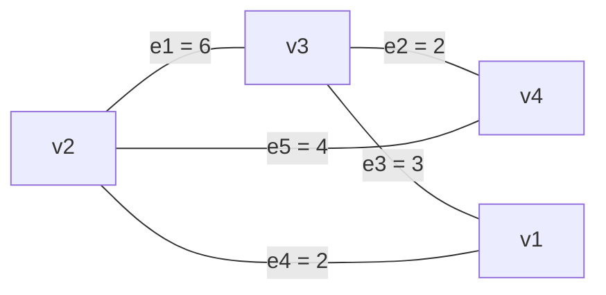
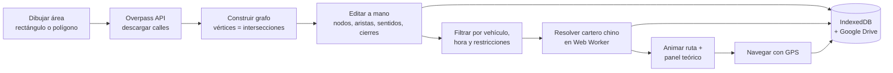
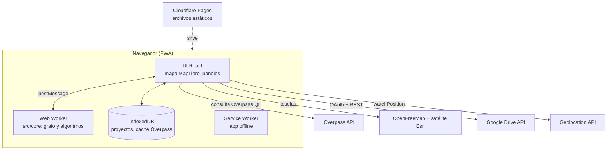

# Cartero Chino en Barranquilla y Soledad: propuesta

Proyecto de Matemáticas Discretas (teoría de grafos). PWA para el celular que toma calles reales de OpenStreetMap, arma el grafo y calcula la ruta más corta que recorre **todas** las calles de un área y vuelve al inicio.

---

## 0. Decisiones clave (resumen)

| Tema | Decisión |
|---|---|
| Backend | **No hace falta.** Todo corre en el navegador: Overpass y Google Drive aceptan llamadas directas (CORS). Se publica como sitio estático en Cloudflare Pages. La Mac mini queda como plan B (ver §3.3). |
| Stack | Vite + TypeScript + React, **MapLibre GL** (mapa vectorial con inclinación y edificios 3D) + terra-draw (dibujar el área), teselas gratis de OpenFreeMap e imágenes satelitales de Esri, Vitest. Más adelante IndexedDB y vite-plugin-pwa. |
| Vistas | Plano, Aérea (satélite desde arriba), 3D (isométrica con edificios), Navegar (tipo Waze: cámara detrás del cartero e instrucción de giro) y Tablero (el grafo dibujado como en clase: v1…vn, e1…em, e4' para las copias). |
| Núcleo | Los algoritmos van en TypeScript puro (`src/core`), sin DOM, dentro de un **Web Worker** para que la interfaz no se congele. Se puede probar con tests unitarios. |
| Algoritmos | BFS (conexo), Dijkstra, emparejamiento perfecto de costo mínimo (máscaras de bits si hay ≤ 20 impares, Blossom de Edmonds exacto hasta 400, Blossom con los 8 impares más cercanos si hay más), Hierholzer. Dirigido: flujo de costo mínimo. Mixto: heurística con cota inferior. |
| A pie | Se **ignoran** los sentidos únicos: un peatón puede caminar contra la vía. El grafo es no dirigido. Los sentidos solo aplican a moto y carro. |
| Límites | **Sin límite de área.** Barranquilla completa se resuelve en ~20 s y Soledad completa en ~3 s (medido, ver §7). La app solo muestra cuánto se caminaría. |
| Sentidos | No hay datos oficiales abiertos con el sentido de las calles (ver §4.3). Se usa `oneway` de OSM y el editor manual. |
| Calles guardadas | Las calles de Barranquilla y Soledad vienen dentro de la app (`public/data/calles-atlantico.json`, 3,9 MB, 866 KB comprimido). Un área dentro de esas ciudades se recorta al instante sin Overpass; fuera de ellas, o con otras opciones de calles, se descarga en vivo con un aviso de progreso (servidor, segundos, MB recibidos, cancelar). |
| Para exponer | Fondo del mapa completo, mínimo (solo agua y nombres) o solo el grafo. Navegación simulada: avanzar indicación por indicación o "caminar" solo, con calles recorridas y lo que falta. |
| MVP | Dibujar área → grafo → ruta animada + panel teórico + 5 vistas + exportar/importar JSON local. Sin Drive, sin GPS, sin restricciones. **Hecho**, falta publicarlo. |

---

## 1. Conexión con la materia

Todo lo visto en clase aparece en la app. Lo nuevo (Dijkstra, emparejamiento, cartero chino) es la extensión natural del teorema de Euler.

| Concepto de clase | Dónde aparece en la app |
|---|---|
| Grafo $G=(V,E)$ | $V$ = intersecciones calle × carrera; $E$ = tramos de calle entre dos intersecciones |
| Peso | Longitud del tramo en metros (fórmula de haversine sobre la geometría) |
| Bucle | Calle que sale y vuelve a la misma intersección (retornos, culatas). Cuenta 2 en el grado |
| Aristas paralelas | Dos calles distintas entre las mismas dos intersecciones y, sobre todo, **las aristas que el cartero duplica**: el grafo final es un multigrafo |
| Grado y apretón de manos | El panel verifica $\sum \deg(v) = 2\lvert E\rvert$ y que el número de impares es par |
| Camino / trayectoria | Dijkstra encuentra la trayectoria más corta entre dos vértices impares |
| Conexo y componentes | BFS. Si el área queda en varios pedazos, se muestran en gris y se usa el más grande |
| Circuito de Euler (teorema) | Si todos los grados son pares, la ruta es un circuito de Euler sin repetir nada |
| Fleury | Se implementa también, para comparar tiempos con Hierholzer en el informe |
| Grafo dirigido, $\deg^+$ y $\deg^-$ | Calles de un sentido. Hay circuito de Euler dirigido si es fuertemente conexo y $\deg^+(v)=\deg^-(v)$ en todo vértice |

### 1.1 El problema

> [!note] Problema del cartero chino (Kwan Mei-Ko, 1962)
> Dado un grafo conexo $G=(V,E)$ con pesos $w(e) > 0$, hallar un **camino cerrado** que pase por cada arista **al menos una vez** con peso total mínimo.

- Si todos los grados son pares → la respuesta es un circuito de Euler y cuesta $\sum w(E)$.
- Si no, hay que repetir aristas. Repetir una arista = agregar una **arista paralela**. Las aristas agregadas deben dejar todos los grados pares, y se puede probar que forman caminos entre parejas de vértices impares. Entonces:

$$\text{costo óptimo} = \sum_{e \in E} w(e) \;+\; \min_{\text{emparejamientos } M \text{ de } O} \sum_{\{u,v\} \in M} d(u,v)$$

donde $O$ es el conjunto de vértices de grado impar (siempre tiene tamaño par por el apretón de manos) y $d(u,v)$ es la distancia más corta.

### 1.1.1 Lo que no se ha visto en clase, explicado fácil

En clase llegamos hasta el **teorema de Euler**: si todos los grados son pares y el grafo es conexo, hay un circuito que pasa por cada arista una sola vez. En una ciudad casi nunca pasa (cada cruce en T tiene grado 3). El proyecto resuelve qué hacer entonces, con tres ideas nuevas:

1. **Dijkstra (camino más corto).** Desde un vértice, va "inundando" el grafo por orden de distancia: primero el vértice más cercano, luego el siguiente, y así. Cuando llega a un vértice, ya sabe la distancia más corta hasta él. Sirve para saber cuánto cuesta ir de un vértice impar a otro.
2. **Emparejamiento perfecto de costo mínimo.** Los vértices impares vienen en parejas (apretón de manos). Hay que juntarlos de dos en dos de forma que la suma de distancias sea la menor posible. Con pocos impares se prueban todas las formas de emparejar de manera inteligente (máscaras de bits); con muchos se usa el algoritmo **Blossom** de Edmonds (1965), que hace lo mismo sin probarlas todas. Por cada pareja se **repiten** las calles del camino más corto entre ellas: eso agrega aristas paralelas y deja todos los grados pares.
3. **Hierholzer.** Es otra forma de construir el circuito de Euler, más rápida que Fleury (la de clase): camina sin repetir aristas hasta volver al inicio; si quedaron aristas sin usar, arma otro circuito desde un vértice del camino y lo empalma. Fleury en cambio revisa en cada paso si está "quemando un puente", y eso lo hace lento con miles de calles.

En resumen: **cartero chino = Euler + repetir lo mínimo**. El modo "Explicar paso a paso" de la app muestra exactamente esos pasos.

### 1.2 Ejemplo con el grafo del tablero (29 oct)

Mismo grafo de la clase, con pesos inventados:



1. Grados: $\deg(v_2)=3$, $\deg(v_3)=3$, $\deg(v_1)=2$, $\deg(v_4)=2$ → $O=\{v_2, v_3\}$. No hay circuito de Euler.
2. Trayectoria más corta $v_2 \to v_3$: directa por $e_1$ cuesta 6, por $v_1$ cuesta $2+3=5$, por $v_4$ cuesta $4+2=6$. Gana $v_2\,e_4\,v_1\,e_3\,v_3$ con costo 5.
3. Se duplican $e_4$ y $e_3$ (**no** la arista directa $e_1$). Ahora todos los grados son pares: $v_1$: 4, $v_2$: 4, $v_3$: 4, $v_4$: 2.
4. Circuito de Euler en el multigrafo:
   $v_2\, e_4\, v_1\, e_3\, v_3\, e_3'\, v_1\, e_4'\, v_2\, e_1\, v_3\, e_2\, v_4\, e_5\, v_2$
5. Costo: $\sum w(E) = 17$, más 5 de lo repetido = **22**. Es un camino cerrado, no un circuito, porque repite $e_3$ y $e_4$.

Este ejemplo va como test unitario del núcleo.

---

## 2. Flujo de la app



### 2.1 Modo "explicar" (para la exposición)

Botón que avanza paso a paso:

1. Grafo crudo con $\lvert V\rvert$, $\lvert E\rvert$ y la verificación del apretón de manos.
2. Vértices de grado impar resaltados en rojo, con su grado.
3. Emparejamiento: líneas punteadas entre cada pareja de impares.
4. Caminos más cortos de cada pareja, pintados como aristas duplicadas (naranja).
5. Circuito animado: azul la primera pasada, naranja las repeticiones, con contador "paso i de m".

Panel teórico fijo: ¿conexo? (componentes), $\lvert O\rvert$, ¿Euler directo?, $\sum w(E)$ ("si cada calle se recorriera una vez"), costo del emparejamiento, distancia total, % extra, algoritmo usado y tiempo de cálculo.

---

## 3. Arquitectura

### 3.1 Componentes



### 3.2 Estructura de carpetas

```
cartero-chino/
├─ src/
│  ├─ core/                 # TS puro, sin DOM (se testea con Vitest)
│  │  ├─ types.ts           # Vertex, Edge, Graph, Solution
│  │  ├─ geo.ts             # haversine, punto en polígono, proyección a segmento
│  │  ├─ build.ts           # OSM → grafo (cortar ways en intersecciones)
│  │  ├─ connectivity.ts    # BFS, componentes, Tarjan (fuertemente conexo)
│  │  ├─ dijkstra.ts        # con montículo binario
│  │  ├─ matching/          # greedy.ts, bitmask.ts, blossom.ts
│  │  ├─ euler.ts           # Hierholzer (+ Fleury para comparar)
│  │  ├─ cpp.ts             # no dirigido
│  │  ├─ cpp-directed.ts    # flujo de costo mínimo
│  │  ├─ cpp-mixed.ts       # heurística + cota inferior
│  │  └─ restrictions.ts    # reglas por zona, día y hora
│  ├─ worker/solver.worker.ts
│  ├─ map/                  # MapLibre: capas, dibujo, vistas, animación
│  ├─ services/             # overpass.ts, drive.ts, store.ts
│  ├─ nav/                  # gps.ts, mapmatch.ts
│  └─ ui/
├─ tests/                   # ejemplos de clase, grafos pequeños vs fuerza bruta
└─ public/manifest.webmanifest
```

### 3.3 ¿Backend en la Mac mini?

No es necesario, porque:

- **Overpass** responde JSON con CORS abierto.
- **Google Drive** se usa con Google Identity Services desde el navegador (token de acceso, sin secreto de servidor).
- **El cálculo** es liviano para los tamaños propuestos (milisegundos; ver §6).

Cuándo sí tendría sentido un servidor:

| Problema | Solución preferida | Mac mini |
|---|---|---|
| Overpass público limita peticiones (error 429) el día de la exposición | Caché en IndexedDB + espejo alterno (`overpass.kumi.systems`). Si no alcanza, una Pages Function con Cache API en el mismo despliegue | Proxy con caché detrás del Cloudflare Tunnel |
| No depender de internet ni de Overpass | Pre-cargar un extracto de Barranquilla + Soledad (Geofabrik → osmium) partido en celdas JSON estáticas dentro de Pages | Overpass propio con el extracto del Atlántico (más montaje del que vale) |

Recomendación: arrancar sin backend y solo agregar la caché si Overpass falla en pruebas.

---

## 4. Construcción del grafo desde OSM

### 4.1 Consulta Overpass

Para un polígono (pares `lat lon` separados por espacio; para rectángulo se usa `(sur,oeste,norte,este)`):

```
[out:json][timeout:25];
way["highway"~"^(trunk|primary|secondary|tertiary|unclassified|residential|living_street|trunk_link|primary_link|secondary_link|tertiary_link)$"]
   ["area"!="yes"]["access"!~"^(private|no)$"]
   (poly:"10.9871 -74.8105 10.9902 -74.8051 ...");
out body geom;
```

El filtro de `highway` depende del modo: a pie se puede activar `pedestrian` y `footway`; `service` va apagado por defecto (parqueaderos, entradas de conjuntos).

### 4.2 Pasos

1. **Detectar intersecciones.** Contar en cuántos ways aparece cada nodo OSM. Es vértice si aparece en ≥ 2 ways, si es extremo de un way, o si se repite dentro del mismo way (bucle). Los demás nodos son solo forma de la curva.
2. **Cortar.** Cada way se parte en sus vértices → una arista por tramo, con su geometría y longitud $= \sum$ haversine entre puntos consecutivos.
3. **Recortar al área.** Se queda la arista si **sus dos extremos** están dentro del polígono. Cortar en el borde crearía vértices de grado 1 (calles sin salida artificiales) y cada uno obliga a ir y volver.
4. **Componentes.** BFS; se usa la componente más grande y las demás se muestran en gris (el usuario puede unirlas en el editor).
5. **Etiquetas.** Cada vértice se nombra con las calles que se cruzan: "Calle 72 × Carrera 46".
6. **Sentidos** (solo moto y carro): `oneway=yes|1|true` → 1, `oneway=-1|reverse` → −1, `junction=roundabout` implica sentido único salvo `oneway=no`.

Casos conocidos que se arreglan en el editor: avenidas con dos calzadas (Vía 40, Murillo, Calle 72, Carrera 54) aparecen como dos calles paralelas de un solo sentido; calles que faltan o mal conectadas en OSM, más frecuentes en Soledad.

### 4.3 ¿Datos oficiales de la Alcaldía?

Se buscó si Barranquilla, Soledad o el Área Metropolitana publican el sentido de las vías:

| Fuente | Qué trae | ¿Sentido? |
|---|---|---|
| [Vías del Distrito](https://www.datos.gov.co/d/6czp-v8zu) (datos.gov.co, 2021, CC BY-SA 4.0) | 18.505 tramos con nombre; se puede consultar desde el navegador | **No** |
| [Jerarquía vial](https://www.datos.gov.co/d/2him-9pmy) y [Perfiles viales](https://www.datos.gov.co/d/aj6f-wwpi) (2021) | Corredores principales, anchos, categorías | **No** |
| Cartografía IGAC 1:2.000 | Tipo de vía, estado, número de carriles | **No** |
| Soledad / AMB | Solo ráster (ortofoto, modelo de terreno) o registros catastrales | **No** |
| Resoluciones de la Secretaría de Tránsito ([ejemplo 2026](https://barranquilla.gov.co/documento/resolucion-0029-de-2026-unico-sentido-calle-75-entre-kra-43-y-48/?version=1)) | Cambios de sentido calle por calle | Sí, pero en PDF y una calle a la vez |

Conclusión: no hay una fuente oficial para cargar sentidos automáticamente. Se usa OSM (`oneway`), y si una calle está mal, se corrige en el editor. Las resoluciones sirven para verificar a mano unas pocas calles y mencionarlo en el informe.

---

## 5. Estructuras de datos

### 5.1 En memoria (núcleo)

Lista de adyacencia de **incidencias**: soporta bucles y aristas paralelas. Una matriz de adyacencia no sirve: no representa paralelas y desperdicia memoria (una ciudad tiene $\lvert E\rvert \approx 2\lvert V\rvert$).

```ts
interface Vertex {
  id: string;            // "n12"
  lat: number; lon: number;
  osmId?: number;
  label?: string;        // "Calle 72 × Carrera 46"
  source: 'osm' | 'manual';
}

interface Edge {
  id: string;            // "e7"
  u: number; v: number;  // índices de vértice (u === v si es bucle)
  length: number;        // metros = peso w(e)
  geometry: [number, number][];  // [lat, lon] de u a v
  name?: string;         // "Carrera 46"
  highway?: string;
  osmWayId?: number;
  oneway: 0 | 1 | -1;    // 1: solo u→v, -1: solo v→u
  closed: boolean;       // cerrada a mano (obra, arroyo)
  source: 'osm' | 'manual';
}

interface Graph {
  vertices: Vertex[];
  edges: Edge[];
  adj: { edge: number; to: number }[][];  // un bucle aparece dos veces en adj[v]
}

type Step = { edge: string; dir: 1 | -1; repeat: boolean };

interface Solution {
  kind: 'euler' | 'cpp' | 'cpp-directed' | 'cpp-mixed';
  start: string;
  oddVertices: string[];
  pairs: [string, string, number][];   // pareja y distancia
  duplicated: string[];                // ids de aristas repetidas (con multiplicidad)
  circuit: Step[];
  baseLength: number;                  // Σ w(E)
  totalLength: number;
  lowerBound?: number;                 // solo en mixto
  matcher: 'bitmask' | 'blossom' | 'greedy';
  ms: number;
  graphHash: string;                   // invalida la solución si se edita el grafo
}
```

### 5.2 Archivos JSON en Google Drive

Carpeta visible `CarteroChino/`:

| Archivo | Contenido |
|---|---|
| `proyectos/<nombre>-<id>.json` | Un archivo por área: área, grafo editado, solución y progreso |
| `restricciones.json` | Zonas y reglas (compartidas entre proyectos) |
| `ajustes.json` | Vehículo, dígito de placa, preferencias |

Cada archivo lleva `appProperties: { app: "cartero-chino", type: "project" }` para listarlos sin recorrer carpetas.

**Proyecto:**

```json
{
  "schema": "cartero-chino/proyecto@1",
  "id": "9f3c2a",
  "name": "El Prado – 4 manzanas",
  "createdAt": "2026-11-03T15:00:00-05:00",
  "updatedAt": "2026-11-03T15:40:00-05:00",
  "area": { "type": "Polygon", "coordinates": [[[-74.8105, 10.9871], [-74.8051, 10.9902], [-74.8040, 10.9850], [-74.8105, 10.9871]]] },
  "source": { "provider": "overpass", "fetchedAt": "2026-11-03T15:01:12Z", "highways": ["residential", "tertiary", "secondary"] },
  "settings": { "mode": "pie", "startVertex": "n1", "departAt": "2026-11-04T07:00:00-05:00" },
  "graph": {
    "directed": "none",
    "vertices": [
      { "id": "n1", "lat": 10.98712, "lon": -74.81050, "osmId": 2512345678, "label": "Calle 72 × Carrera 46", "source": "osm" }
    ],
    "edges": [
      { "id": "e1", "u": "n1", "v": "n2", "length": 93.4, "name": "Calle 72", "highway": "secondary",
        "osmWayId": 23456789, "oneway": 0, "closed": false, "source": "osm",
        "geometry": [[10.98712, -74.81050], [10.98730, -74.80965]] }
    ],
    "edits": [ { "at": "2026-11-03T15:20:00Z", "op": "close", "edge": "e14", "note": "arroyo" } ]
  },
  "solution": {
    "kind": "cpp", "start": "n1", "oddVertices": ["n3", "n8"], "pairs": [["n3", "n8", 187.2]],
    "duplicated": ["e4", "e9"], "baseLength": 2140.5, "totalLength": 2327.7,
    "matcher": "bitmask", "ms": 3, "graphHash": "a1b2c3",
    "circuit": [ { "edge": "e1", "dir": 1, "repeat": false } ]
  },
  "progress": {
    "done": { "e1": "2026-11-04T07:03:10-05:00" },
    "cursor": 1,
    "sessions": [ { "start": "2026-11-04T07:00:00-05:00", "end": null, "track": "polilínea codificada" } ]
  }
}
```

**Restricciones:**

```json
{
  "schema": "cartero-chino/restricciones@1",
  "zones": [
    {
      "id": "z1", "name": "Zona sin parrillero",
      "geometry": { "type": "Polygon", "coordinates": [[[-74.80, 10.98], [-74.79, 10.98], [-74.79, 10.99], [-74.80, 10.98]]] },
      "rules": [ { "applies": ["moto_parrillero"], "days": [1,2,3,4,5,6,7], "from": "00:00", "to": "23:59", "effect": "forbid" } ]
    },
    {
      "id": "z2", "name": "Soledad nocturno",
      "geometry": { "type": "Polygon", "coordinates": [[[-74.77, 10.91], [-74.76, 10.91], [-74.76, 10.92], [-74.77, 10.91]]] },
      "rules": [ { "applies": ["moto"], "days": [5,6,7], "from": "22:00", "to": "05:00", "effect": "forbid" } ]
    },
    {
      "id": "z3", "name": "Pico y placa centro",
      "geometry": { "type": "Polygon", "coordinates": [[[-74.79, 10.97], [-74.78, 10.97], [-74.78, 10.98], [-74.79, 10.97]]] },
      "rules": [ { "applies": ["carro"], "kind": "pico_placa", "from": "07:00", "to": "19:00", "effect": "forbid",
                   "digitsByDay": { "1": [1,2], "2": [3,4], "3": [5,6], "4": [7,8], "5": [9,0] } } ]
    }
  ]
}
```

- Días ISO: 1 = lunes … 7 = domingo. Si `to < from`, la franja cruza la medianoche.
- `ajustes.json` guarda el **dígito** que cuenta para el pico y placa, no la placa completa.
- Una regla de pico y placa sin zona (polígono de toda la ciudad) significa "ese día no puedes salir en ese vehículo": la app lo avisa en vez de calcular.

---

## 6. Algoritmos

### 6.1 Tabla resumen

$n=\lvert V\rvert$, $m=\lvert E\rvert$, $k=\lvert O\rvert$ (vértices impares).

| Paso | Algoritmo | Complejidad |
|---|---|---|
| Longitud de tramos | Haversine | $O(\text{puntos})$ |
| ¿Conexo? componentes | BFS | $O(n+m)$ |
| ¿Fuertemente conexo? (dirigido) | Tarjan | $O(n+m)$ |
| Distancias entre impares | Dijkstra desde cada impar (montículo binario) | $O(k\,(n+m)\log n)$ |
| Emparejamiento exacto, $k \le 20$ | Programación dinámica con máscaras de bits | $O(2^k\, k)$ |
| Emparejamiento exacto, $k > 20$ | Blossom de Edmonds (1965) | $O(k^3)$ |
| Emparejamiento de referencia | Voraz (para mostrar que no es óptimo) | $O(k^2 \log k)$ |
| Circuito | Hierholzer | $O(m)$ |
| Circuito (comparación) | Fleury | $O(m^2)$ |
| Dirigido | Flujo de costo mínimo (caminos sucesivos más cortos) | $O(F\,(n+m)\log n)$ |
| Mixto | Heurística (NP-difícil, Papadimitriou 1976) | polinomial |

### 6.2 No dirigido (a pie)

```
1. G ← componente más grande (BFS)
2. O ← { v : deg(v) impar }               // |O| es par (apretón de manos)
3. si O = ∅: devolver Hierholzer(G, inicio)
4. para cada u ∈ O: Dijkstra(u) → dist[u][·], pred[u][·]
5. M ← emparejamiento perfecto de costo mínimo en K_|O| con pesos dist
6. para cada {u,v} ∈ M: duplicar las aristas de la trayectoria u→v (pred)
7. devolver Hierholzer(G + duplicadas, inicio)
```

**Emparejamiento con máscaras de bits** (fácil de explicar en la exposición):

```
dp[0] = 0, dp[resto] = ∞
para mask de 0 a 2^k − 1, si dp[mask] < ∞:
    i ← primer bit apagado de mask
    para cada j > i apagado en mask:
        nuevo ← mask | (1<<i) | (1<<j)
        dp[nuevo] ← min(dp[nuevo], dp[mask] + dist[i][j])
respuesta: dp[2^k − 1]   (guardando de dónde vino para reconstruir las parejas)
```

Con $k=20$ son ~20 millones de operaciones: menos de 0,2 s. Para más impares se usa Blossom: se porta `max_weight_matching` de NetworkX (o el paquete `edmonds-blossom`) con pesos $W - d(u,v)$ y cardinalidad máxima, que equivale al perfecto de costo mínimo.

En una cuadrícula como la de Barranquilla los vértices del borde del área quedan con grado 3 y los cruces en T también son impares, así que $k$ pasa de 20 muy rápido. Por eso Blossom no es opcional.

**Hierholzer** (iterativo, $O(m)$):

```
pila ← [inicio]; circuito ← []; ptr[v] ← 0; usada[e] ← falso
mientras pila no vacía:
    v ← tope(pila)
    avanzar ptr[v] mientras adj[v][ptr[v]] esté usada
    si ptr[v] = grado(v): circuito.push(pop(pila))
    si no: (e, w) ← adj[v][ptr[v]]; usada[e] ← verdadero; push(pila, w)
invertir(circuito)
```

Comparado con Fleury (visto en clase), Hierholzer no necesita preguntar "¿esta arista es puente?" en cada paso, que cuesta un BFS cada vez.

### 6.3 Dirigido exacto (todas las calles de un sentido)

1. Debe ser **fuertemente conexo** (Tarjan). Si no, se avisa qué calles dejan vértices sin salida.
2. Para cada vértice, $\delta(v) = \deg^-(v) - \deg^+(v)$. Si $\delta(v) > 0$ le faltan salidas; si $\delta(v) < 0$ le faltan entradas.
3. Problema de transporte: enviar $\delta$ unidades de los que les faltan salidas a los que les faltan entradas, con costo $d(u,v)$ (Dijkstra dirigido). Se resuelve con flujo de costo mínimo.
4. Duplicar los arcos de esos caminos → $\deg^+ = \deg^-$ en todos → Hierholzer dirigido.

### 6.4 Mixto (algunas calles de un sentido): heurística

El problema exacto es NP-difícil, así que se hace:

1. Orientar cada calle de doble sentido de forma voraz, en la dirección que reduce el desequilibrio $\lvert\delta(u)\rvert + \lvert\delta(v)\rvert$.
2. Resolver el dirigido exacto (§6.3) sobre esa orientación, dejando el sentido contrario de las calles dobles disponible como arco de paso (se puede usar, no es obligatorio).
3. Mejora local: probar invertir cada calle doble, recalcular, quedarse con lo mejor (cabe en el tiempo para estos tamaños).
4. **Cota inferior**: el cartero no dirigido sobre el mismo grafo (ignorar sentidos relaja restricciones, así que nunca da más). El panel muestra "heurística: X km, cota inferior: Y km, brecha ≤ Z %".

### 6.5 Restricciones

Antes de resolver se filtran aristas:

- `closed = true` → se elimina.
- Si el modo es moto o carro y la arista cae (algún punto de su geometría) dentro de una zona con una regla activa para ese vehículo a la hora de salida → se elimina.

Las aristas eliminadas no se recorren ni son obligatorias. Si el grafo queda partido, se muestran las componentes y se resuelve la más grande. Si la ruta estimada (distancia ÷ velocidad del modo) cruza el inicio de una franja prohibida, la app lo advierte.

---

## 7. Tamaño: se puede la ciudad completa

No hay límite de área. Medido con `npm run bench` sobre calles reales de OSM (vías de carro, sin troncales), en el PC:

| Área | Vértices | Aristas | Impares | Σ w(E) | Repetido | Recorrido total | Tiempo |
|---|---|---|---|---|---|---|---|
| Barranquilla completa | 11.163 | 17.922 | 6.804 | 1.568 km | 324 km (20,6 %) | ~1.892 km | ~19 s |
| Soledad completa | 5.839 | 8.904 | 4.022 | 588 km | 154 km (26,2 %) | ~742 km | ~3 s |
| Demo El Prado (0,48 km²) | 48 | 75 | 36 | 6,6 km | 1,1 km | 7,7 km | < 0,1 s |

Casi todo el tiempo se va en el emparejamiento. Con más de 400 impares, Blossom sobre todos los pares sería demasiado lento ($6804^2/2 \approx 23$ millones de candidatos), así que cada impar solo considera a sus **8 impares más cercanos** (Dijkstra acotado). Dos detalles para que eso no empeore la ruta:

- Si un grupo de impares solo tiene candidatos entre ellos y son una cantidad impar (un barrio unido al resto por una sola vía larga), es imposible emparejarlos a todos dentro del grupo. Se detectan esos grupos y se agrega la conexión más corta hacia afuera.
- Con 8, 12 y 20 vecinos el resultado de Barranquilla fue 323,7, 322,4 y 322,2 km repetidos: con 8 se queda a 0,5 % y es lo más rápido. El panel dice "casi óptimo" cuando se usa este modo, y "exacto" con máscaras de bits o Blossom completo.

Lo que sí crece es el tiempo humano: Barranquilla completa a pie son unas 380 h. La app lo muestra antes de animar.

---

## 8. Navegación con GPS

- `navigator.geolocation.watchPosition` con alta precisión + **Wake Lock** para que la pantalla no se apague. Una PWA no recibe GPS con la pantalla apagada o en segundo plano: es una limitación del navegador y hay que decirlo en el informe.
- **Map matching**: índice espacial de rejilla (celdas de 50 m). Se buscan aristas a menos de $\max(20\text{ m}, \text{precisión})$ y se prefiere la siguiente arista esperada del circuito.
- Una arista se marca recorrida cuando la posición proyectada cubrió ≥ 80 % de su longitud (en vehículo, en el sentido permitido).
- Si el usuario se sale de la ruta: Dijkstra hasta el punto más cercano del circuito que siga pendiente y se continúa desde ahí. Recalcular un cartero solo con las calles pendientes es el problema del cartero rural (NP-difícil), así que no se hace.
- El progreso se guarda en IndexedDB cada pocos segundos y en Drive cada pocos minutos o al pausar.

---

## 9. Google Drive

- Google Cloud: crear proyecto → habilitar Drive API → cliente OAuth "Aplicación web" con orígenes autorizados (`http://localhost:5173` y el dominio de Pages).
- Alcance `drive.file`: la app solo ve los archivos que ella misma creó. Con la pantalla de consentimiento en modo "Prueba" (hasta 100 usuarios de prueba) no hace falta la verificación de Google.
- Google Identity Services (token client) en el navegador. El token dura ~1 h y se renueva sin pedir permiso de nuevo.
- REST con `fetch`: `files.list` con `q = "appProperties has { key='app' and value='cartero-chino' } and trashed=false"`, `files.create` multipart para crear y `PATCH .../upload/drive/v3/files/{id}?uploadType=media` para actualizar.
- Primero local: IndexedDB es la fuente principal y Drive se sincroniza cuando hay internet (gana el `updatedAt` más reciente).

---

## 10. Plan por fases

Estimado para una persona a medio tiempo.

| Fase | Entrega | Terminado cuando… | Días |
|---|---|---|---|
| **0. Base** ✅ (falta publicar) | Repo Vite + TS + React + MapLibre. Falta desplegarlo en Cloudflare Pages | Se abre el mapa centrado en Barranquilla desde el celular | 0,5 |
| **1. MVP** ✅ | Dibujar rectángulo o polígono, o elegir Barranquilla/Soledad completas → Overpass → grafo → cartero no dirigido (Dijkstra + máscaras de bits + Blossom + Hierholzer) → animación + 5 vistas + panel teórico + modo explicar. Ejemplos de clase (tablero 29 oct, corbatín, Königsberg) y demo de El Prado sin internet. Exportar/importar JSON. 10 tests | En El Prado la ruta se anima, el total coincide con $\sum w + $ emparejamiento y los tests pasan | 5–7 |
| **1b. Ruta de A a B** ✅ | Buscar un lugar ("Estadio Metropolitano", "Portal del Prado") o usar "Mi ubicación" del GPS, y llevar de un punto a otro por el camino más corto (Dijkstra sobre las calles guardadas), con la misma navegación tipo Waze. Buscador: Photon (gratis, datos de OSM). A pie o en carro/moto (respeta sentidos únicos), con opción de ida y vuelta | Metropolitano → Portal del Prado: 7,47 km por calles (7,08 km en línea recta), 66 vértices, Dijkstra explora 13.614 intersecciones en 7 ms | 1–2 |
| **2. Editor** ✅ (básico) | Agregar/quitar nodos, unir/borrar aristas, partir una arista, cerrar calle, deshacer/rehacer; recalcular | Cerrar una calle cambia los impares y la ruta en vivo | 3 |
| **3. Guardado** 🟡 (Drive listo, falta el ID de cliente; falta PWA) | IndexedDB + Google Drive + PWA instalable y offline | Se cierra la app, se abre en otro dispositivo y el proyecto aparece desde Drive | 2–3 |
| **4. Vehículos y sentidos** | Modo moto/carro, `oneway` desde OSM, editar sentidos, Tarjan, dirigido exacto con flujo, mixto con cota | Un área de solo sentidos únicos da $\deg^+ = \deg^-$ tras duplicar; el mixto muestra la brecha | 4 |
| **5. Restricciones** | Dibujar zonas, reglas por días, horas y vehículo, pico y placa por dígito | Una zona prohibida para moto a las 22:00 desaparece del grafo a esa hora y vuelve a las 06:00 | 3 |
| **6. GPS** | Modo navegación, map matching, progreso, regreso a la ruta | Caminando una ruta corta se marcan las calles recorridas | 3–4 |
| **7. Informe** | Experimentos y documento | Ver abajo | 2 |

**Experimentos para el informe:**

- Emparejamiento voraz vs. óptimo: cuánto peor queda la ruta.
- Fleury vs. Hierholzer: tiempo según el número de aristas.
- % de distancia extra en una cuadrícula (El Prado) frente a un barrio irregular de Soledad, explicado por la cantidad de impares.

---

## 11. Riesgos

| Riesgo | Mitigación |
|---|---|
| Overpass caído o con límite de peticiones | Caché local, espejo alterno, proxy en Pages Function si hace falta |
| Datos de OSM incompletos (sentidos sin etiquetar, calles que faltan, sobre todo en Soledad) | Editor manual; es justo para lo que existe |
| Avenidas de doble calzada duplican el recorrido | Opción de borrar una calzada en el editor; mencionarlo en el informe |
| GPS con error de 5–15 m entre edificios | Umbral de 20 m y preferir la arista esperada |
| Arroyos cuando llueve | Botón "cerrar calle" con nota |
| Restricciones reales cambian por decreto | Por diseño las define el usuario; la app no promete que estén al día |
